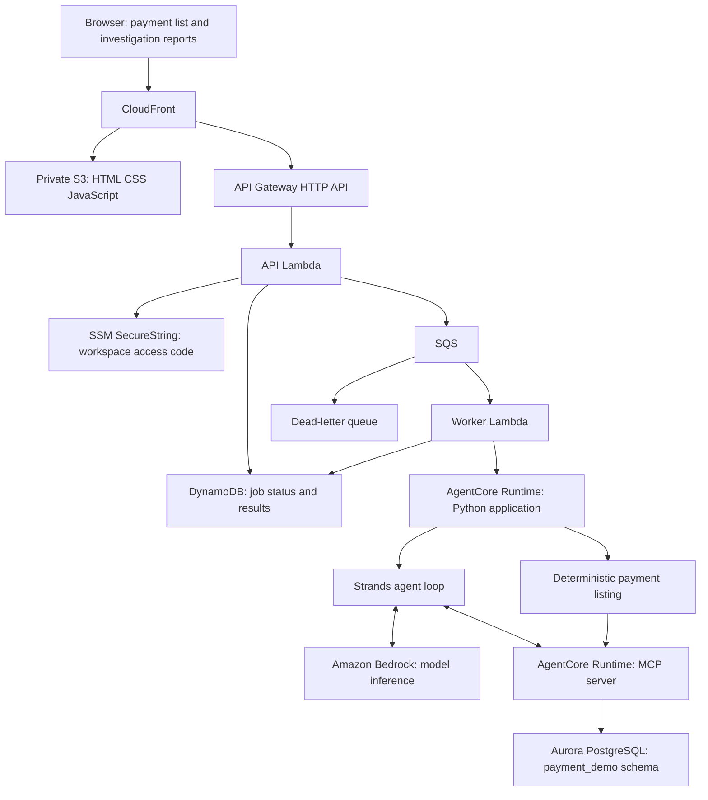
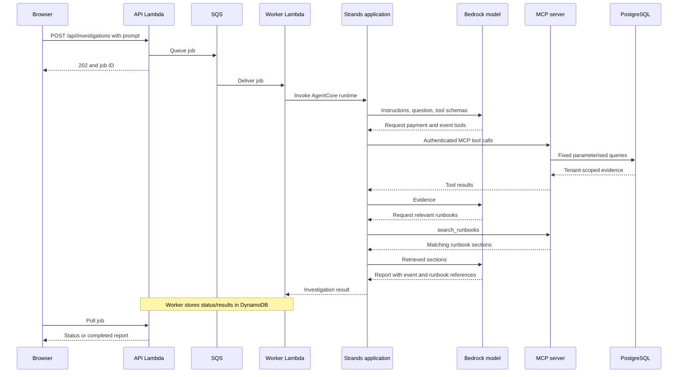

# Payment Analysis Platform

Author: Nixon

A payment operations workspace for viewing synthetic payments and investigating incidents using recorded events and operational runbooks. Python provides the API, MCP tools and Strands application; Amazon Bedrock provides model inference.

## System design



### Investigation request



## Components and data

| Path | Responsibility |
|---|---|
| `mcp_server.py` | Database access, typed MCP tools and resources |
| `agent.py` | Strands execution loop, Bedrock model access, MCP transport |
| `agent_runtime.py` | AgentCore entrypoint and deterministic payment listing |
| `db/` | Schema, synthetic fixtures and verification queries |
| `web/app.py` | Local FastAPI application |
| `web/static/` | Payment and investigation screens |
| `web/aws/` | Asynchronous Lambda API/worker, infrastructure and deployment scripts |

PostgreSQL tables are `payment_demo.tenants`, `payments`, `payment_events` and `runbook_sections`. MCP exposes `list_payments`, `get_payment`, `get_payment_events` and `search_runbooks`, plus guide/runbook resources. Runbook retrieval supplies context to the model: retrieval-augmented generation. Inspect `search_runbooks` for the exact database search implementation; this source does not contain an embedding or vector indexing pipeline.

## Local setup

1. Install Python and PostgreSQL; create a development database.
2. Run `db/01_schema.sql`, `db/02_seed.sql`, then `db/03_verify.sql` with `psql` against that database. Use synthetic data only.
3. Create a virtual environment and install `requirements.txt`. Copy `.env.mcp.example` to `.env.mcp`, supply local database settings, then run `python mcp_server.py`.
4. Use a separate virtual environment for `requirements-agent.txt` to keep SDK dependencies isolated. Copy `.env.agent.example` to `.env.agent`; configure an accessible Bedrock model and an authenticated AWS profile. Run `python agent.py --check-tools`, then `python agent.py "Investigate payment PAY-1042"`.
5. For the web app, install `web/requirements.txt` in its own environment, configure `.env.web` using the example and run `python -m uvicorn web.app:app --host 127.0.0.1 --port 8085`. This UI invokes the configured AWS agent runtime.

## AWS deployment and security

See `HOST_AGENT.md` and `web/aws/README.md`. Deployment scripts are configured for the original development account: review account IDs, runtime ARNs, region, IAM resources and parameter names before using another account. GitHub hosting does not change the deployed AWS resources.

The hosted agent signs MCP requests with IAM. MCP generates a fresh IAM database token per connection and verifies the database TLS hostname with `verify-full`. Database queries use a server-configured tenant and do not accept arbitrary SQL. The demo website uses a shared workspace access code from encrypted SSM; it does not provide separate user accounts or a general multi-tenant identity system.

SQS and polling avoid holding an HTTP API request open during investigation. Jobs have a 24-hour expiry; the API rejects expired reports even before eventual TTL deletion. Duplicate delivery handling prevents re-running an already claimed invocation. A worker crash after claiming a job needs operational inspection. CloudWatch logs, a dead-letter queue and throttling support diagnosis and cost control.

Cold starts and Aurora resume can delay evidence retrieval. MCP startup and request timeouts allow additional time, with bounded database connection retries. A tool failure must be reported as incomplete evidence, never as proof that a payment is missing. A bank timeout does not prove payment failure. The agent is read-only: no payment submission or ticket creation.

## Validation

```powershell
python -m pytest web/test_app.py web/aws/test_handlers.py -q
```

These tests use simulated dependencies; a configured AWS environment is needed for end-to-end validation. No credentials, local environment files or packaged deployment archives are included.

## Source scope

This repository contains the available Python/MCP payment investigation application. Kafka ingestion is not present in this source snapshot and is not represented as a deployed component in the system design.
